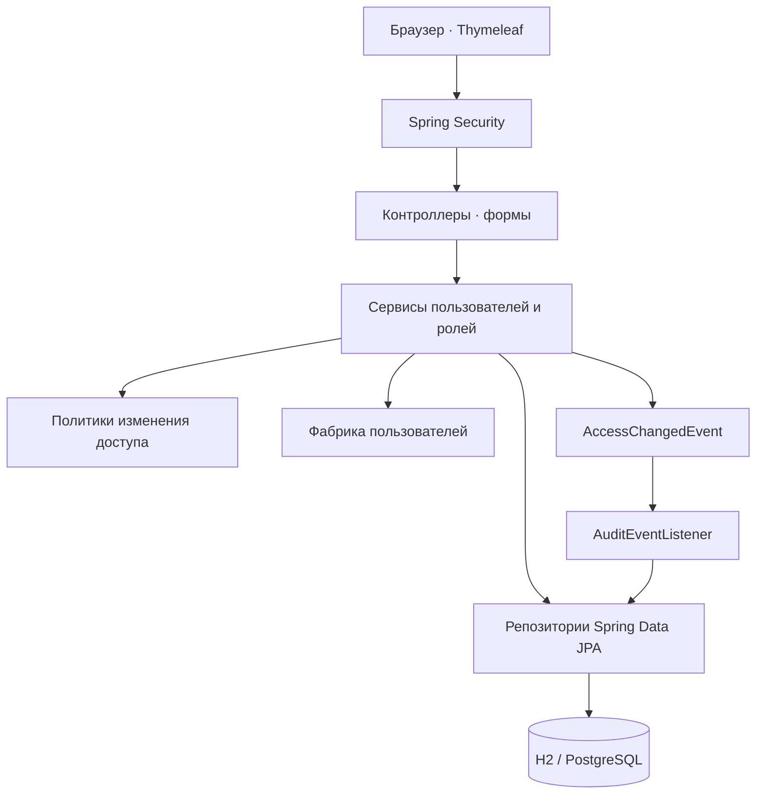
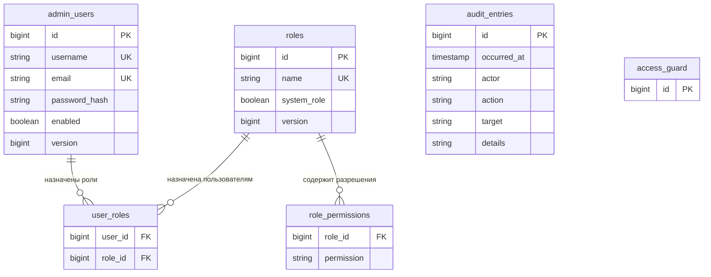

# Корпоративная админ-панель

Веб-приложение на Java и Spring Boot для управления пользователями корпоративного сервиса, ролями и правами доступа. Интерфейс на русском языке: вход в систему, сводная панель, пользователи, редактор ролей и журнал административных действий.

Проект демонстрирует применение SOLID и паттернов проектирования в работающем приложении с проверкой прав на сервере и хранением данных в реляционной базе.

## Возможности

- Просмотр статистики пользователей, ролей и действий.
- Создание и редактирование пользователей, блокировка и разблокировка учётных записей, смена пароля.
- Назначение пользователю нескольких ролей.
- Создание и редактирование ролей с отдельным выбором каждого разрешения.
- Проверка прав при выполнении операций; скрытие недоступных элементов интерфейса.
- Аудит изменений пользователей и ролей без записи паролей и их хешей.
- Защита системной роли `ADMIN` и последнего активного администратора.
- Сохранение данных между запусками; миграции схемы через Flyway.

## Технологии

| Компонент | Назначение |
| --- | --- |
| Java 21 | Язык и среда выполнения |
| Spring Boot 3.5.16 | Конфигурация и запуск приложения |
| Maven 3.9.9 через Maven Wrapper | Воспроизводимая сборка без отдельной установки Maven |
| Spring MVC, Thymeleaf | Серверный веб-интерфейс |
| Spring Security | Аутентификация, авторизация, BCrypt и CSRF |
| Spring Data JPA, Hibernate | Работа с сущностями и репозиториями |
| Jakarta Validation | Проверка данных форм |
| Flyway | Версионирование схемы базы данных |
| H2 | Локальная база данных для разработки |
| PostgreSQL | База данных для профиля `prod` |
| JUnit, Spring Boot Test, Spring Security Test | Проверки поведения и безопасности |

## Быстрый запуск

Потребуется **JDK 21**. Убедитесь, что `JAVA_HOME` указывает на установленный JDK и команда `java -version` показывает версию 21. При первом запуске необходим доступ к сети для загрузки Maven и зависимостей.

Из корня проекта в Windows PowerShell:

```powershell
.\mvnw.cmd spring-boot:run
```

В Linux или macOS:

```bash
chmod +x mvnw
./mvnw spring-boot:run
```

Откройте [http://localhost:8080](http://localhost:8080). По умолчанию используется профиль `dev` с файловой базой H2 `data/admin-db`. Данные остаются после остановки приложения. Каталог `data/` исключён из Git. При необходимости измените порт переменной окружения `PORT`.

### Учётные записи для разработки

При первом запуске с пустой таблицей пользователей создаются демонстрационные учётные записи:

| Логин | Пароль | Роль и доступ |
| --- | --- | --- |
| `admin` | `AdminDemo2026!` | `ADMIN`: все разрешения |
| `manager` | `ManagerDemo2026!` | `MANAGER`: чтение и изменение пользователей, просмотр ролей; без назначения ролей |
| `auditor` | `AuditorDemo2026!` | `AUDITOR`: просмотр пользователей, ролей и аудита |

Эти данные предназначены для локального знакомства с приложением. Профиль `prod` использует отдельные настройки первого администратора. Повторный запуск с заполненной таблицей пользователей не восстанавливает демонстрационные пароли и не перезаписывает существующие учётные записи.

Для проверки интерфейса войдите как `admin`, создайте роль с нужными разрешениями, создайте пользователя и назначьте ему роль. В отдельном окне браузера войдите под новым пользователем и проверьте доступность разделов. Вернитесь в сессию администратора, измените права роли или заблокируйте пользователя — изменения учитываются на следующих запросах пользователя.

## Права доступа

Права пользователя — объединение разрешений всех назначенных ему ролей. Роль с произвольным названием сама по себе не даёт доступа: значение имеют её разрешения.

| Разрешение | Что позволяет |
| --- | --- |
| `USER_READ` | Просматривать пользователей |
| `USER_WRITE` | Создавать и изменять пользователей, менять состояние учётной записи и пароль |
| `ROLE_READ` | Просматривать роли |
| `ROLE_WRITE` | Создавать роли и редактировать их разрешения |
| `ROLE_ASSIGN` | Назначать и изменять роли пользователей |
| `AUDIT_READ` | Просматривать журнал действий |

Назначение ролей проверяется отдельно от редактирования пользователя. Для операций с назначением ролей необходимо `ROLE_ASSIGN` в дополнение к праву изменения пользователя. Без него можно создать пользователя без ролей или изменить данные существующего пользователя, сохранив его роли. Системная роль `ADMIN` содержит полный набор разрешений и не редактируется через интерфейс.

Только пользователь с ролью `ADMIN` может создавать и изменять учётные записи администраторов и пользователей с разрешениями управления доступом `ROLE_WRITE` или `ROLE_ASSIGN`. Делегировать эти разрешения также может только `ADMIN`. Привилегированные роли не предлагаются для назначения другим операторам, а подстановка их идентификаторов в запрос проверяется на сервере.

Логин существующей учётной записи неизменяем. Новый пароль должен содержать не менее 12 символов и занимать не более 72 байт в UTF-8; для нелатинских символов количество байт отличается от количества символов. Пустое поле пароля при редактировании сохраняет текущий пароль.

### Защита административных операций

- Пароли хранятся как хеши BCrypt. Исходный пароль не показывается повторно и не попадает в аудит.
- Spring Security защищает формы от CSRF; изменяющие запросы требуют действительного CSRF-токена.
- Ограничения действуют на сервере: ручной запрос к закрытому маршруту не обходит скрытую кнопку.
- Права и состояние учётной записи проверяются заново при запросах, поэтому изменение роли или блокировка учитывается и в уже открытой сессии.
- Смена пароля завершает прежние сессии пользователя при их следующем запросе; для продолжения требуется вход с новым паролем.
- Изменения не должны оставлять систему без активного пользователя с ролью `ADMIN`. Проверка защищена блокировкой в базе данных, чтобы параллельные запросы не могли одновременно отключить последних администраторов.
- Версии сущностей используются для обнаружения конкурирующих изменений пользователей и ролей.
- Изменение данных и запись аудита выполняются в одной транзакции: при откате изменения запись о его успешном выполнении также не сохраняется.

## Архитектура



Исходный код находится в `src/main/java/com/company/admin/`:

| Пакет | Ответственность |
| --- | --- |
| `config` | Конфигурация безопасности и создание начальных учётных записей |
| `domain` | Пользователи, роли, разрешения и записи аудита |
| `repository` | Доступ к данным и блокировка административных изменений |
| `service` | Сценарии управления пользователями и ролями |
| `service/policy` | Независимые правила допустимости изменения пользователя |
| `security` | Аутентификация и проверка актуальных прав |
| `audit` | События изменений и их синхронная обработка |
| `web` | HTTP-контроллеры и обработка ошибок |
| `web/form` | Формы и ограничения входных данных |

Шаблоны расположены в `src/main/resources/templates/`, стили — в `src/main/resources/static/`, SQL-миграции — в `src/main/resources/db/migration/`. Настройки окружений разделены на профили разработки и `prod`.

### SOLID в проекте

| Принцип | Как применяется |
| --- | --- |
| **S — Single Responsibility** | Контроллер принимает запрос, сервис выполняет сценарий, политика проверяет ограничение, репозиторий работает с данными, слушатель записывает аудит. Эти обязанности разделены между классами. |
| **O — Open/Closed** | Дополнительную проверку изменения доступа можно реализовать как новую `AccessMutationPolicy`. Spring передаст её в список политик; существующие проверки не требуется изменять. |
| **L — Liskov Substitution** | Реализации политик соблюдают общий контракт: проверяют допустимость операции, не изменяют сохраняемое состояние и отклоняют операцию при нарушении правила. Для новой реализации важно сохранить этот контракт, включая поведение при ошибках; одного наличия интерфейса для соблюдения LSP недостаточно. |
| **I — Interface Segregation** | Небольшой интерфейс `AccessMutationPolicy` описывает проверку правила и не заставляет реализации заниматься HTTP, сохранением пользователя или аудитом. |
| **D — Dependency Inversion** | Сервисы получают интерфейсы репозиториев, политик и `ApplicationEventPublisher` через внедрение зависимостей Spring. Они не создают конкретные реализации вручную. |

### Паттерны проектирования

| Паттерн | Реализация | Практическая польза |
| --- | --- | --- |
| **Repository** | [UserRepository](src/main/java/com/company/admin/repository/UserRepository.java), [RoleRepository](src/main/java/com/company/admin/repository/RoleRepository.java), [AuditRepository](src/main/java/com/company/admin/repository/AuditRepository.java), [AccessGuardRepository](src/main/java/com/company/admin/repository/AccessGuardRepository.java) | Сервисы используют интерфейсы доступа к данным; SQL и детали JPA не смешиваются с HTTP-обработкой. |
| **Strategy** | [AccessMutationPolicy](src/main/java/com/company/admin/service/policy/AccessMutationPolicy.java), [LastAdministratorPolicy](src/main/java/com/company/admin/service/policy/LastAdministratorPolicy.java), [PrivilegedAccountPolicy](src/main/java/com/company/admin/service/policy/PrivilegedAccountPolicy.java) | Правила изменения доступа подключаются через единый контракт и проверяются независимо. |
| **Factory** | [UserFactory](src/main/java/com/company/admin/service/UserFactory.java) | Создание пользователя и подготовка хеша пароля сосредоточены в одном месте. Это простая фабрика, а не иерархия GoF Factory Method. |
| **Observer** | `ApplicationEventPublisher`, [AccessChangedEvent](src/main/java/com/company/admin/audit/AccessChangedEvent.java), [AuditEventListener](src/main/java/com/company/admin/audit/AuditEventListener.java) | Сервис сообщает о выполненном изменении событием, а отдельный слушатель формирует запись аудита в той же транзакции. |

### Модель данных



`access_guard` содержит строку для блокировки административных изменений. `audit_entries` хранит логин исполнителя и описание события, поэтому журнал не зависит от последующего изменения отображаемого имени пользователя.

## Сборка и проверка

Windows:

```powershell
.\mvnw.cmd verify
java -jar target/corporate-admin-1.0.0.jar
```

Linux/macOS:

```bash
./mvnw verify
java -jar target/corporate-admin-1.0.0.jar
```

`verify` запускает проверки и собирает исполняемый JAR. Если запускаете JAR без профиля `prod`, приложение использует настройки разработки и те же демонстрационные данные при пустой таблице пользователей.

[AdminSecurityIntegrationTest](src/test/java/com/company/admin/AdminSecurityIntegrationTest.java) проверяет реальные MVC-маршруты и аутентификацию через MockMvc:

- Вход, неверный пароль, перенаправление анонимных пользователей и отображение страниц.
- Различия доступа администратора, менеджера и аудитора.
- Создание и изменение пользователей и ролей, хеширование паролей и запись аудита без секретов.
- Запрет подделки назначения ролей и захвата учётных записей с полномочиями управления доступом.
- CSRF, выход из системы и защиту системной роли `ADMIN`.
- Защиту последнего активного администратора и отклонение устаревшей версии формы.
- Применение изменённых прав в открытой сессии, завершение сессии после блокировки или смены пароля.
- Отклонение некорректных и повторяющихся данных без создания пользователя и записи об успешной операции.

Проверки используют профиль `test` с отдельной базой H2 в памяти, поэтому не изменяют локальные данные из `data/`.

## Запуск с PostgreSQL

Профиль `prod` требует отдельную PostgreSQL-базу. Настройки задаются переменными окружения:

| Переменная | Значение |
| --- | --- |
| `SPRING_PROFILES_ACTIVE` | `prod` |
| `DB_URL` | JDBC-адрес, например `jdbc:postgresql://localhost:5432/corporate_admin` |
| `DB_USERNAME` | Пользователь PostgreSQL; обязателен для приложения |
| `DB_PASSWORD` | Пароль пользователя PostgreSQL; обязателен |
| `ADMIN_USERNAME` | Логин первого администратора; по умолчанию `admin` |
| `ADMIN_PASSWORD` | Собственный пароль первого администратора; необходим при пустой таблице пользователей |
| `ADMIN_EMAIL` | Email первого администратора; по умолчанию `admin@example.com` |
| `PORT` | Порт приложения; по умолчанию `8080` |

**Для входа в профиль `prod` обязателен HTTPS:** cookie сессии имеет флаг `Secure`. Разместите приложение за HTTPS-прокси или настройте TLS для сервера перед использованием браузера. При доступе по обычному HTTP браузер не отправит cookie сессии, и вход не будет сохраняться. Для локальной проверки по HTTP используйте профиль `dev`. Настройка HTTPS-прокси не входит в `compose.yml`.

### PostgreSQL через Docker Compose

[compose.yml](compose.yml) запускает только PostgreSQL 17. Нужен Docker с поддержкой Compose. Установите `DB_PASSWORD` в окружении процесса; для Compose это обязательная переменная. `DB_USERNAME` по умолчанию равен `corporate_admin`, имя базы — `corporate_admin`.

Windows PowerShell, после установки собственного `DB_PASSWORD`:

```powershell
$env:DB_USERNAME = 'corporate_admin'
docker compose up -d --wait postgres
```

Linux/macOS, после экспорта собственного `DB_PASSWORD`:

```bash
export DB_USERNAME=corporate_admin
docker compose up -d --wait postgres
```

Compose публикует порт только на `127.0.0.1:5432`, сохраняет данные в томе `postgres_data` и проверяет готовность через `pg_isready`. Используйте `DB_URL=jdbc:postgresql://localhost:5432/corporate_admin` для приложения, запущенного на том же компьютере. Команда `docker compose stop postgres` остановит базу с сохранением данных. Переменные Compose не устанавливаются автоматически в окружение Java-процесса: приложение должно получить свои `DB_URL`, `DB_USERNAME` и `DB_PASSWORD`.

### Запуск приложения

Подготовьте базу через Compose или создайте базу и пользователя в существующем PostgreSQL. Установите переменные в окружении процесса и запустите собранный JAR:

```powershell
.\mvnw.cmd verify
$env:SPRING_PROFILES_ACTIVE = 'prod'
$env:DB_URL = 'jdbc:postgresql://localhost:5432/corporate_admin'
$env:DB_USERNAME = 'corporate_admin'
# Установите DB_PASSWORD, ADMIN_USERNAME, ADMIN_PASSWORD и ADMIN_EMAIL
# в окружении процесса либо через используемое хранилище секретов.
java -jar target/corporate-admin-1.0.0.jar
```

Или в Linux/macOS после установки перечисленных переменных:

```bash
./mvnw verify
SPRING_PROFILES_ACTIVE=prod java -jar target/corporate-admin-1.0.0.jar
```

Flyway применяет миграции при запуске; Hibernate проверяет соответствие сущностей схеме. Начальный администратор создаётся **только при пустой таблице `admin_users`**. В профиле `prod` демонстрационные `manager` и `auditor` не создаются. Изменение `ADMIN_PASSWORD` после инициализации базы не меняет пароль существующего пользователя: для этого используйте форму смены пароля в панели. Для уже заполненной базы параметры создания первого администратора не используются.

## Границы проекта

Это учебная реализация корпоративной админ-панели с RBAC. Для внедрения в организацию понадобятся требования и отдельная доработка интеграции с корпоративным каталогом или SSO, MFA, восстановления доступа, разграничения доступа по подразделениям и эксплуатации. Текущие роли распространяются на панель целиком; интеграции с внешними корпоративными сервисами в проекте нет.

Демонстрационные учётные записи профиля разработки имеют опубликованные пароли. Для окружения с реальными данными используйте профиль `prod`, собственные секреты, HTTPS на входе, резервное копирование и ограниченный доступ к PostgreSQL. Аудит хранится в той же базе и не является отдельным неизменяемым архивом.

## Документация используемых технологий

- [Требования Spring Boot 3.5](https://docs.spring.io/spring-boot/3.5/system-requirements.html).
- [CSRF в Spring Security](https://docs.spring.io/spring-security/reference/servlet/exploits/csrf.html).
- [Авторизация HTTP-запросов в Spring Security](https://docs.spring.io/spring-security/reference/servlet/authorization/authorize-http-requests.html).
